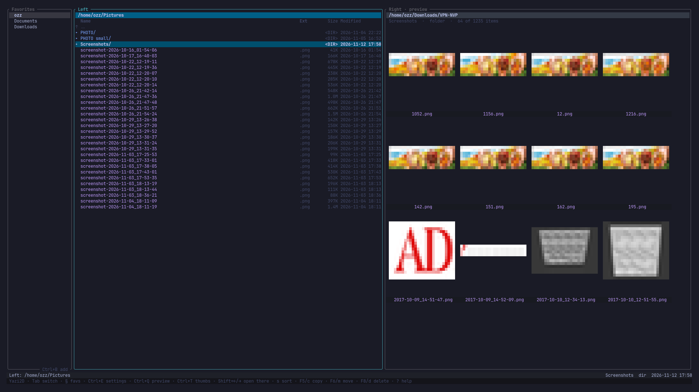
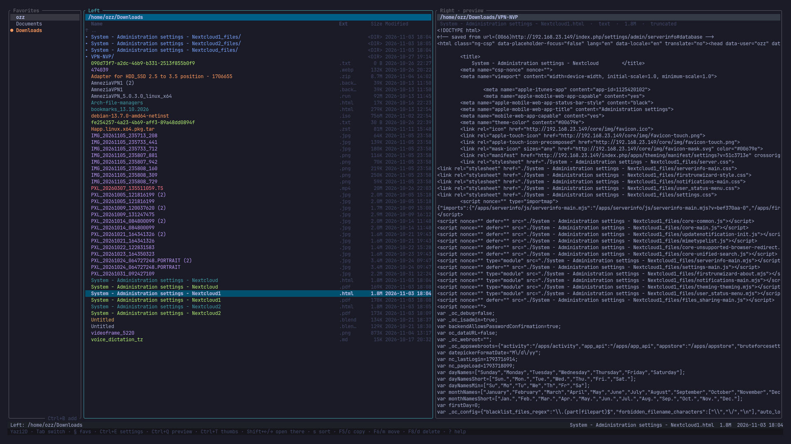
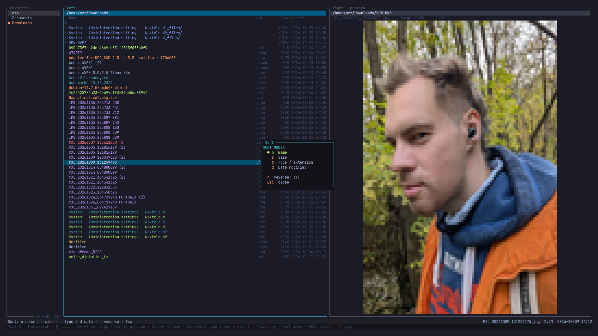
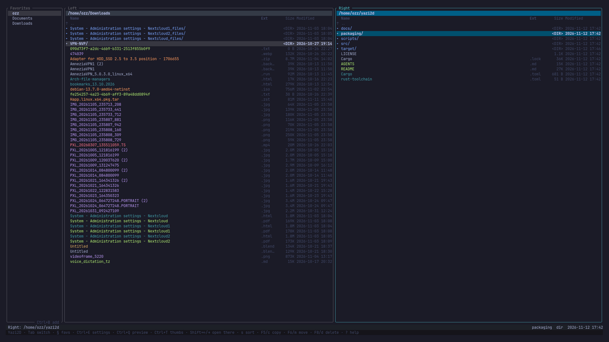

# Yazi2D

**English** · [Русский](#yazi2d--русский)

A fast dual-pane terminal file manager. A spiritual fork of
[Yazi](https://github.com/sxyazi/yazi): Yazi's speed and clean TUI, with a
deliberately simplified Total Commander workflow.

> **Status:** working MVP `0.6.0`. Two independent panels, a path bar on each,
> persistent favorites, copy/move between panels, quick preview, thumbnail grid,
> background directory loading, diagnostics log, sorting, per-type colours,
> bulk rename, rebindable keys, full mouse support and recursive search.
> Windows binaries, including a Windows 7 build, are in `dist/windows`.

```
┌ Favorites ─────────────┐┌ Left ──────────────────────┐┌ Right · preview ───────────┐
│ ● Home                 ││ /Users/me/Projects         ││ /Users/me/Projects         │
│   Downloads            ││   Name       Ext     Size  ││  README.md · text · 8.1K   │
│   Documents            ││ ▸ src/                     ││  # Yazi2D                  │
│   Desktop              ││ ▸ assets/                  ││                            │
│                        ││   README.md  .md     8.1K  ││  A fast dual-pane terminal │
│                        ││   photo.jpg  .jpg    2.3M  ││  file manager…             │
└ Ctrl+B add ────────────┘└────────────────────────────┘└────────────────────────────┘
 Copied 3 item(s).                                  README.md  file  2026-11-11 09:41
 Yazi2D · Tab switch · § favs · Ctrl+E settings · Ctrl+Q preview · Ctrl+T thumbs · s sort · F5/c copy · ? help
```

## Screenshots

Every screenshot is taken in [Ghostty](https://ghostty.org), the terminal where
the truecolor previews and thumbnails look best.

List view with a folder preview on the right:



Text preview of a file selected in the left panel:



Thumbnail grid and file preview in one window:



Favorites sidebar with a folder tree:



## Features

- **Two panels** with independent working directories, cursor and selection.
- **Sharp previews**: the terminal's own graphics protocol (kitty in Ghostty,
  kitty, WezTerm or foot; iTerm2; sixel) draws real pixels instead of half-block
  pixels, picked from the environment — no blocking query, no broken input.
  Half blocks remain the fallback.
- **Yazi icons**: Nerd Font glyph per file name and extension, coloured from
  Yazi's theme (`icons = false` in the settings file turns them off).
- **Fast arrows**: holding ↑/↓ accelerates (55 ms → 12 ms, 1 → 4 rows), so a
  long listing is crossed in a second, and reaching the top or bottom jumps to
  the other end without stopping — Total Commander style.
- **Chip footer**: every key sits on its own light-orange plate, built from the
  live bindings. Holding Ctrl, Alt, Shift or Cmd replaces the footer with that
  modifier's screen only; releasing it restores the default.
- **Mouse everywhere**: click a row to move the cursor, double click to open,
  click the **path bar to copy the path**, right click for a context menu
  (open, copy path/name, select, rename, delete, new folder, find).
- **Recursive search** on `Alt+F7` with `*`/`?` masks, a live result list and
  `Tab` to open the hit in the other panel.
- **Path bar** at the top of each panel (left-truncated, the tail is always visible).
- **Favorites sidebar** — bookmarks that survive restarts.
- **Copy/move between panels** (`F5`/`F6` or `c`/`m`), recursive, symlink-aware, confirmed before running.
- **Background operations** with progress; the UI stays navigable.
- **Quick preview** (`Ctrl+Q`/`Ctrl+P`): the **opposite** panel shows text, an
  image, or a folder grid and follows the cursor. Read-only.
- **Folder facts at a glance**: the `Ext` column shows how many folders a
  folder contains, and `Space` on a folder measures its size in the background
  (shown in the `Dir` column, in K/M/G).
- **Thumbnail grid** (`Ctrl+T`) with cached image tiles and block-art icons per file type.
- **Favorites, hidden files, mkdir, rename, delete, bulk rename, select-all.**
- **Sorting** by name, size, type or date, with reverse.
- **Per-type colours** with three presets and a preview menu.
- **Rebindable keys** and trackpad inversion in an in-app settings menu.
- **Layout-independent shortcuts**: they work with the Russian keyboard layout.
- **Background directory loading** — no freezes on slow or cloud folders.
- **Diagnostics log** with timings and `WARN` lines for slow paths.
- **Delete goes to the trash**: `Del`/`F8` move to the system trash
  (freedesktop on Linux, `~/.Trash` on macOS, the real recycle bin on Windows),
  so a wrong key press is recoverable. `Shift+Del` erases permanently and says
  so in the prompt.
- **Clipboard**: `Ctrl+L` copies the path, `Alt+I` the name, `Ctrl+Shift+C`
  the selected paths — through `pbcopy`/`wl-copy`/`xclip`/`clip`, with OSC 52
  as a fallback for terminals without a helper.
- **macOS app bundle** with a custom icon (`packaging/macos/build-app.sh`).
- **Windows binaries**: `dist/windows/yazi2d-x86_64-windows.exe` (10/11) and
  `dist/windows/yazi2d-x86_64-win7.exe` (7/8/8.1).

## Install

**One command to remember: `y2d`.**

```sh
git clone https://github.com/wonderrozz-coder/yazi2d.git
cd yazi2d
y2d setup          # build, install the icon app, put y2d on PATH
```

If `./y2d` says `permission denied` (Nextcloud strips the executable bit), run
the first one through bash: `bash y2d setup`.

Everyday commands — identical on macOS and Linux:

| Command | What it does |
|---|---|
| `y2d run` | build (debug) and **start it right here** |
| `y2d run ~/Projects ~/Downloads` | same, with both panels set |
| `y2d app` | build release, install the system icon |
| `y2d update` | `git pull` + rebuild + reinstall |
| `y2d test` | fmt + clippy + unit tests + PTY end-to-end |
| `y2d note "text"` | leave a comment for the agent in `docs/FEEDBACK.md` |
| `y2d notes` | read the comments back |
| `y2d status` | version, git state, binary paths |
| `y2d log 60` | last 60 lines of the runtime log |
| `y2d clean` | remove build artifacts |

Where the icon lands:

| Platform | Icon | Binary |
|---|---|---|
| macOS | `/Applications/Yazi2D.app` — Launchpad, Spotlight, Dock | `~/.local/bin/yazi2d` |
| Linux | "Yazi2D" in the application menu (`~/.local/share/applications/yazi2d.desktop`) | `~/.local/bin/yazi2d` |

**Working on two machines:** `y2d setup` once per machine, then `y2d update`
after working elsewhere. It refuses to pull when there are uncommitted changes,
so nothing gets lost.

### By hand, without `y2d`

```sh
cargo build --release
./target/release/yazi2d ~/Projects ~/Downloads
```

Rust stable (1.80+) is required. If Rust is not installed:

```sh
curl --proto '=https' --tlsv1.2 -sSf https://sh.rustup.rs | sh -s -- -y --profile minimal
source "$HOME/.cargo/env"
```

The binary lands in `target/release/yazi2d` (≈2 MB) and can be copied to
`~/.local/bin` or `/usr/local/bin`.

### macOS app icon

```sh
bash packaging/macos/build-app.sh
```

This builds **Yazi2D.app** with a custom icon and installs it to
`/Applications`, so it appears in Launchpad, Spotlight and the Dock. Because
Yazi2D is a terminal UI, the app opens a terminal window and starts there.

The launcher picks the best terminal automatically, preferring ones with
**truecolor** so image previews and thumbnails render correctly:

```
Ghostty → kitty → WezTerm → iTerm2 → Terminal.app (last resort)
```

Terminal.app has no truecolor support, so previews appear as black blocks
there. Install [Ghostty](https://ghostty.org) to get the full experience.
Pass `--no-copy` to build into `dist/` without installing.

### Linux application entry

```sh
bash packaging/linux/build-desktop.sh
```

Installs the binary to `~/.local/bin/yazi2d`, icons into
`~/.local/share/icons/hicolor/*/apps/` and a launcher into
`~/.local/share/applications/yazi2d.desktop`, so Yazi2D appears in the
application menu (GNOME, KDE, XFCE, Cinnamon). The entry uses
`Terminal=true`, so your own terminal opens. Pass `--no-install` to stage
everything in `dist/linux/` instead.

The icon is generated from `packaging/icon-source.png`; regenerate it with
`python3 packaging/render-icon.py` (no dependencies, pure stdlib).

### Windows

Ready-to-run binaries live in `dist/windows/`:

| File | Windows |
|---|---|
| `yazi2d-x86_64-windows.exe` | 10 / 11 |
| `yazi2d-x86_64-win7.exe` | 7 / 8 / 8.1 |

Run it from **Windows Terminal**, **Ghostty** or **ConEmu** — a plain
`cmd.exe` window works too, but only those terminals draw the truecolor image
previews and the thumbnail grid correctly. Windows Terminal is preinstalled on
Windows 11 and installable from the Microsoft Store on Windows 10.

Rebuild them on Linux (Arch example):

```sh
sudo pacman -S mingw-w64-gcc zip
rustup target add x86_64-pc-windows-gnu
rustup +nightly component add rust-src

./packaging/windows/build-windows.sh          # both binaries
WIN7=0 ./packaging/windows/build-windows.sh   # Windows 10/11 only
```

Both files are self-contained: no Visual C++ runtime, no DLLs, no installer.

> **Windows 7.** Rust dropped Windows 7 support, but the
> `x86_64-win7-windows-gnu` target family keeps building for it. Because
> rustup ships no prebuilt `std` for those targets, the script compiles the
> standard library from source (`-Z build-std`), which is why the Windows 7
> build needs a nightly toolchain. The resulting EXE imports only
> `kernel32`, `user32`, `advapi32`, `ole32`, `shell32` and `msvcrt` — all
> present since Windows 7.

> **Ghostty on Windows.** Ghostty is currently macOS/Linux only, with no
> official Windows build, so it cannot be bundled into the Windows zip yet.

> If the repository lives in a synced folder (Nextcloud/Dropbox), keep build
> artifacts out of it: `export CARGO_TARGET_DIR="$HOME/.cache/yazi2d-target"`.

## Keys

On macOS, function keys may require `Fn`; every essential action has a letter
alternative.

| Keys | Action |
|---|---|
| `Tab` | switch active panel |
| `↑`/`k`, `↓`/`j` | move cursor (scroll in preview) |
| `PgUp`/`PgDn`, `Home`/`g`, `End`/`G` | page, top, bottom |
| `Enter` / `l` / `→` | open folder; for a file, open with its associated app |
| `Backspace` / `h` / `←` | go to parent directory |
| `Space` / `Insert` | select and move down; on a folder, measure its size |
| `Esc` | clear selection / close preview / cancel |
| `F5` / `c` | copy to the other panel (confirm with `Enter`/`y`) |
| `F6` / `m` | move to the other panel (confirm with `Enter`/`y`) |
| `F7` / `n` | create folder |
| `F2` / `r` | rename |
| `F8` / `d` / `Delete` | delete (confirm with `Enter`/`y`) |
| `Ctrl+Q` / `Ctrl+P` | quick preview in the **other** panel |
| `Ctrl+T` | thumbnail grid |
| `Shift+←` / `Shift+→` | open cursor folder in that panel |
| `Alt+←` / `Alt+→` | quick preview in that panel |
| `Ctrl+O` | open cursor folder in the other panel |
| `§` / `Shift+Tab` / `Ctrl+D` | focus favorites / back to panels |
| `Ctrl+B` / `a` | add current folder to favorites |
| `Ctrl+F` | show / hide the favorites sidebar |
| `Ctrl+A` | select everything |
| `Ctrl+G` | bulk rename by pattern |
| `s` / `Ctrl+S` | sort menu (name/size/type/date, `r` reverses) |
| `Ctrl+K` | colour menu for file types |
| `Ctrl+E` | settings: key bindings and trackpad |
| `Ctrl+R` | refresh both panels |
| `Ctrl+H` / `.` | toggle hidden files |
| `?` / `F1` | help |
| `q` / `Ctrl+C` | quit |

Every key in this table is a **default**: all of them can be changed in `Ctrl+E`,
including `Esc`, the settings key and help. `Ctrl+C` is the one exception — it is
the terminal's interrupt.

Favorites sidebar: `↑`/`↓` select, `Enter` open, `Delete`/`d` remove,
`Esc`/`Shift+Tab` back to panels.

Preview: `↑`/`↓` scroll, `←`/`→` horizontal scroll,
`Ctrl+Q`/`Ctrl+P`/`Esc` close.

Thumbnails: arrows/`hjkl` move, `Enter` opens, `Ctrl+T` back to the list.

**Trackpad:** two-finger scroll moves the list (inverted, as if dragging).
**Double tap with two fingers** opens the entry under the cursor: a folder is
entered, a file is opened with the system default app (`open`, `xdg-open`,
`explorer`). Single taps and horizontal scroll are deliberately inert — macOS
emits horizontal scroll inside vertical gestures and it used to cause random
navigation.

**Settings (`Ctrl+E`):** `i` flips the trackpad direction, arrows + `Enter`
rebind an action, `r` restores its defaults. Stored in
`$YAZI2D_CONFIG_DIR/settings.toml`. `Ctrl+E` and `Esc` cannot be rebound.

**Layout independence:** shortcuts work with the Russian layout — `Ctrl+и` is
`Ctrl+B`, `ы` is `s`, `в` is `d`, matched by physical key. Prompts still type
exactly the characters you press.

**Modifier hints:** hold `Ctrl`, `Option` (`Alt`), `Shift` or `Command` and the
footer shows only the chords for that modifier (requires the kitty keyboard
protocol: Ghostty, kitty, WezTerm, foot, iTerm2).

> **Modifiers are split on purpose.** `Shift+←/→` opens the folder in the other
> panel, `Option+←/→` previews there. `Ctrl+←/→` switches macOS Spaces, and
> Ghostty rewrites `Cmd+←/→` into `Ctrl+A`/`Ctrl+E` before the app sees them, so
> neither is used. Ghostty encodes `Option+←/→` as `Esc b`/`Esc f`; Yazi2D accepts
> `Option+b`/`Option+f` too, so it works without touching the terminal config.

## Images and icons

Previews use the terminal's native graphics protocol when it has one:

| Terminal | Protocol |
|---|---|
| Ghostty, kitty, WezTerm, foot, Konsole | kitty graphics |
| iTerm2 | iTerm2 inline images |
| foot, mlterm, xterm (`-ti vt340`) | sixel |
| macOS Terminal, plain xterm | half blocks (a warning is shown instead of dithered pixels) |

Detection is deliberately a pure environment check (`TERM`, `TERM_PROGRAM`,
`COLORTERM`). The escape-sequence query that `ratatui-image` ships with enables
raw mode and ends by restoring it to *off*, and it leaves a thread blocked on
`read()` when the terminal stays silent — that swallowed every keystroke. This
app never queries stdin, so it cannot break input.

Override the choice when a multiplexer hides the terminal's identity:

```sh
YAZI2D_IMAGE_PROTOCOL=kitty yazi2d      # or iterm2, sixel, halfblocks
```

Icons come from Yazi's default theme: 713 mappings — folder names (`Documents`,
`Downloads`, `.git`…), exact file names (`.gitignore`, `README`…) and
extensions (`*.rs`, `*.png`, `*.tar.gz`…). They need a **Nerd Font**; without
one the glyphs render as boxes, and `icons = false` in the settings file switches
the listing back to plain ASCII markers.

## Configuration

Favorites: `~/.config/yazi2d/favorites.toml`
(macOS: `~/Library/Application Support/yazi2d/favorites.toml`).
Override the directory with `YAZI2D_CONFIG_DIR`.

```toml
# Each row keeps the order shown in the sidebar. A row is a path or a
# separator ("separator" with a title), and a path may be a file.
[[group]]
kind = "path"
path = "/Users/me/Projects"

[[group]]
kind = "separator"
title = "Work"

[[group]]
kind = "path"
path = "/Volumes/Backup"

[[group]]
kind = "path"
path = "/Users/me/notes.md"     # files can be bookmarked too
```

In the sidebar: `↑↓` browse (the active panel follows the cursor — a folder
opens, a file is previewed), `Enter`/`→` commit, `PageUp/PageDown` (or `K`/`J`,
because a Mac has no reachable PgUp/PgDn) move the row, `S` add a separator,
`Del` remove. A flat `favorites = ["/a", "/b"]` list from older versions still
loads.

**Mounted volumes** sit under the bookmarks and share the same cursor: `↓` past
the last bookmark steps into the Disks section, `↑↓` walk the volumes, `Enter`
opens one in the active panel, and `↑` from the first volume returns to the
bookmarks.

Settings: `$YAZI2D_CONFIG_DIR/settings.toml`.

```toml
invert_scroll = true
icons = true            # Nerd Font glyphs in the listing
max_thumb_bytes = 4194304

# Two slots per action, both editable in the settings menu (Ctrl+E).
# An empty string frees a key without replacing it.
key.copy.1 = "f5"
key.copy.2 = "c"
key.quit.1 = ""         # q is free now…
key.toggle_preview.1 = "q"   # …and preview took it
```

Only actions that differ from the defaults are written, so the file stays short
and new defaults reach existing users.

**Every key is rebindable — there are no exceptions.** `Esc`, `Ctrl+E` and the
first slot of the settings menu itself can all be reassigned in `Ctrl+E`. If
both settings slots end up empty, the menu is still reachable with the mouse:
right-click any row and choose *Settings (key bindings)*. The only key the app
does not own is `Ctrl+C`, the terminal's interrupt — taking it away would make a
wedged app impossible to stop.

## Logging

```sh
YAZI2D_LOG=off yazi2d                    # disable
YAZI2D_LOG=/tmp/yazi2d.log yazi2d        # custom path
tail -f ~/Library/Application\ Support/yazi2d/yazi2d.log
```

Every directory load is logged with its duration; loads over 250 ms are marked
`WARN slow directory load`. Look for the last `INFO load start` line to find the
directory that stalled.

## Development

```sh
y2d test        # fmt + clippy -D warnings + unit tests + PTY end-to-end
y2d run         # build (debug) and start it
```

The same gates by hand:

```sh
source "$HOME/.cargo/env"

cargo fmt --check
cargo clippy --all-targets -- -D warnings
cargo test --all-targets
cargo build --release

python3 scripts/e2e_pty.py target/debug/yazi2d   # real-PTY end-to-end test
```

MIT licensed — see [`LICENSE`](LICENSE). Design notes live in
[`docs/DECISIONS.md`](docs/DECISIONS.md), the module map in
[`docs/ARCHITECTURE.md`](docs/ARCHITECTURE.md), and the handoff guide in
[`AGENTS.md`](AGENTS.md).

## Limitations

- No overwrite prompt: conflicting names get a ` (1)` suffix instead.
- No cancelling a running background operation.
- Images are drawn with half blocks in truecolor; no sixel/Kitty/iTerm2 protocol.
- No file editor, search, archives or SSH/SFTP.
- Deletion is permanent (no trash).

## Origin

Yazi2D is an independent Rust + [ratatui](https://ratatui.rs) codebase inspired
by Yazi (architecture ideas, speed, TUI aesthetics) and Total Commander (the
two-panel model). No Yazi source is included.

---

# Yazi2D — Русский

[English](#yazi2d) · **Русский**

Быстрый двухпанельный файловый менеджер для терминала. Идейный форк
[Yazi](https://github.com/sxyazi/yazi): скорость и лаконичный TUI от Yazi,
модель работы — упрощённый Total Commander.

> **Статус:** рабочий MVP `0.6.0`. Две независимые панели, строка текущего пути,
> избранное, копирование и перемещение между панелями, быстрый просмотр,
> режим миниатюр, фоновая загрузка каталогов, файловый лог, сортировка, цвета
> по типам, массовое переименование, переназначаемые клавиши, полноценная мышь
> и рекурсивный поиск. В `dist/windows` лежат готовые сборки под Windows,
> включая Windows 7.

```
┌ Favorites ─────────────┐┌ Left ──────────────────────┐┌ Right · preview ───────────┐
│ ● Дом                  ││ /Users/me/Projects         ││ /Users/me/Projects         │
│   Загрузки             ││   Name       Ext     Size  ││  README.md · text · 8.1K   │
│   Документы            ││ ▸ src/                     ││  # Yazi2D                  │
│   Рабочий стол         ││ ▸ assets/                  ││                            │
│                        ││   README.md  .md     8.1K  ││  Быстрый двухпанельный     │
│                        ││   photo.jpg  .jpg    2.3M  ││  файловый менеджер…        │
└ Ctrl+B add ────────────┘└────────────────────────────┘└────────────────────────────┘
 Copied 3 item(s).                                  README.md  file  2026-11-11 09:41
 Yazi2D · Tab switch · § favs · Ctrl+E settings · Ctrl+Q preview · Ctrl+T thumbs · s sort · F5/c copy · ? help
```

## Скриншоты

Снято в [Ghostty](https://ghostty.org) — терминале, где truecolor-превью и
миниатюры выглядят так, как задумано.

Список и сетка миниатюр папки в соседней панели:


Просмотр текста выбранного файла:


Режим миниатюр и превью в одном окне:


Избранное и список файлов:


## Возможности

- **Две панели** с независимыми текущими каталогами, курсором и выделением.
- **Строка пути** в верхней части каждой панели (обрезается слева, хвост всегда виден).
- **Резкие превью**: картинки рисует сам терминал своим графическим протоколом
  (kitty в Ghostty, kitty/WezTerm/foot, iTerm2, sixel) — это настоящие пиксели,
  а не полублоки. Протокол определяется по переменным окружения, без
  блокирующего запроса, поэтому ввод не ломается. Полублоки остаются запасным
  вариантом.
- **Иконки как в Yazi**: глиф Nerd Font для имени и расширения, цвет — из темы
  Yazi (`icons = false` в файле настроек отключает их).
- **Быстрые стрелки**: зажатая ↑/↓ ускоряется (55 мс → 12 мс, 1 → 4 строки),
  длинный список пролетает за секунду; у верхнего и нижнего края курсор
  перескакивает на противоположный и продолжает движение — как в Total Commander.
- **Футер-плашки**: каждая клавиша на своей бледно-оранжевой плашке, набор
  берётся из реальных привязок. Зажатый Ctrl, Alt, Shift или Cmd заменяет
  футер экраном только этого модификатора; отпустили — вернулся обычный.
- **Мышь**: клик по строке ставит курсор, двойной клик открывает, клик по
  **строке пути копирует путь**, правая кнопка открывает контекстное меню
  (открыть, копировать путь/имя, выделить, переименовать, удалить, создать
  папку, найти).
- **Рекурсивный поиск** по `Alt+F7`: маски `*`/`?`, живой список результатов,
  `Tab` — открыть найденное в другой панели.
- **Удаление — в корзину**: `Del`/`F8` перемещают в системную корзину
  (freedesktop в Linux, `~/.Trash` на macOS, настоящая корзина в Windows),
  поэтому случайное нажатие обратимо. `Shift+Del` стирает безвозвратно и
  предупреждает об этом в подтверждении.
- **Буфер обмена**: `Ctrl+L` — путь, `Alt+I` — имя, `Ctrl+Shift+C` — пути
  выделенных файлов; через `pbcopy`/`wl-copy`/`xclip`/`clip` с OSC 52 как
  резервным способом для терминалов без утилиты.
- **Избранное** — боковая панель с закладками; сохраняется между запусками.
- **Копирование и перемещение между панелями** (`F5`/`F6` или `c`/`m`),
  рекурсивно, с поддержкой симлинков и подтверждением перед запуском.
- **Фоновые операции** с прогрессом: интерфейс не блокируется.
- **Быстрый просмотр** (`Ctrl+Q`/`Ctrl+P`): **противоположная** панель показывает
  текст, изображение или сетку каталога и следует за курсором. Только чтение.
- **Папка «на glance»**: в колонке `Ext` у папки стоит число вложенных папок
  первого уровня, а `Space` на папке считает её объём в фоне (показывается в
  колонке `Dir` в К/М/Г).
- **Сетка миниатюр** (`Ctrl+T`) с кэшем изображений и блочными иконками по типам.
- **Избранное, скрытые файлы, создание, переименование, удаление, массовое переименование, выделить всё.**
- **Сортировка** по имени, размеру, типу или дате, с реверсом.
- **Цвета по типам файлов**: три темы и меню предпросмотра.
- **Переназначаемые клавиши** и инверсия трекпада в меню настроек.
- **Горячие клавиши не зависят от раскладки**: работают и в русской.
- **Фоновая загрузка каталогов** — без зависаний на медленных и облачных папках.
- **Диагностический лог** с таймингами и `WARN` для медленных путей.
- **Приложение для macOS** с иконкой (`packaging/macos/build-app.sh`).
- **Бинарники для Windows**: `dist/windows/yazi2d-x86_64-windows.exe` (10/11)
  и `dist/windows/yazi2d-x86_64-win7.exe` (7/8/8.1).

## Быстрый старт: одна команда `y2d`

Держать в голове длинные команды не нужно — в репозитории лежит скрипт `y2d`,
который делает всё сам и на **macOS, и на Linux**.

Один раз на машине:

```sh
git clone https://github.com/wonderrozz-coder/yazi2d.git
cd yazi2d
y2d setup          # соберёт, поставит приложение и положит `y2d` в PATH
```

Если `./y2d` отвечает `permission denied` (Nextcloud снимает бит исполнения),
запустите первый раз через bash — дальше работает обычная команда:

```sh
bash y2d setup
```

Дальше каждый день:

| Команда | Что делает |
|---|---|
| `y2d run` | быстро собирает debug-сборку и **запускает здесь же** |
| `y2d run ~/Projects ~/Downloads` | то же с двумя панелями |
| `y2d app` | собирает release и ставит ярлык в систему |
| `y2d update` | `git pull` + пересборка + переустановка ярлыка |
| `y2d test` | fmt + clippy + юнит-тесты + PTY-тест |
| `y2d note "текст"` | оставить комментарий для агента в `docs/FEEDBACK.md` |
| `y2d notes` | прочитать эти комментарии |
| `y2d status` | версия, состояние git, где лежат бинарники |
| `y2d log 60` | последние 60 строк лога |
| `y2d clean` | удалить артефакты сборки |

Комментарий можно передать и многострочно:

```sh
echo "первая мысль
вторая мысль" | y2d note
```

**Работа на двух машинах.** На второй машине достаточно:

```sh
git clone https://github.com/wonderrozz-coder/yazi2d.git && cd yazi2d && bash y2d setup
```

а потом после работы на любой из машин — `y2d update`. Он откажется тянуть
изменения, если есть незакоммиченные правки, чтобы ничего не потерять.

### Где что появляется

| Платформа | Ярлык | Бинарник |
|---|---|---|
| macOS | `/Applications/Yazi2D.app` — иконка в Launchpad, Spotlight, Dock | `~/.local/bin/yazi2d` |
| Linux | пункт «Yazi2D» в меню приложений (`~/.local/share/applications/yazi2d.desktop`) | `~/.local/bin/yazi2d` |

На macOS ярлык открывает окно терминала (лучшего из установленных: Ghostty →
kitty → WezTerm → iTerm2 → Terminal.app). На Linux в `.desktop` стоит
`Terminal=true`, поэтому открывается ваш собственный терминал.

### Вручную, без `y2d`

```sh
cargo build --release
./target/release/yazi2d ~/Projects ~/Downloads
```

Нужен Rust stable (1.80+). Если Rust ещё не установлен:

```sh
curl --proto '=https' --tlsv1.2 -sSf https://sh.rustup.rs | sh -s -- -y --profile minimal
source "$HOME/.cargo/env"
```

### Приложение с иконкой для macOS

```sh
bash packaging/macos/build-app.sh
```

Собирает **Yazi2D.app** с иконкой и устанавливает в `/Applications` — приложение
появится в Launchpad, Spotlight и Dock. Yazi2D — терминальный интерфейс, поэтому
при запуске открывается окно терминала и программа стартует в нём.

Лаунчер сам выбирает лучший терминал, отдавая приоритет тем, что поддерживают
**truecolor** — без этого превью и миниатюры выглядят чёрными квадратами:

```
Ghostty → kitty → WezTerm → iTerm2 → Terminal.app (крайний случай)
```

В Terminal.app нет truecolor, поэтому картинки там будут плоскими. Поставьте
[Ghostty](https://ghostty.org), чтобы получить полную картинку. Флаг
`--no-copy` собирает бандл в `dist/` без установки.

Иконка генерируется из `packaging/icon-source.png`; перерисовать её можно
командой `python3 packaging/render-icon.py` (без зависимостей, только stdlib).

### Приложение в меню Linux

```sh
bash packaging/linux/build-desktop.sh
```

Кладёт бинарник в `~/.local/bin/yazi2d`, иконку в
`~/.local/share/icons/hicolor/*/apps/` и ярлык
`~/.local/share/applications/yazi2d.desktop`. После этого Yazi2D запускается из
меню приложений (GNOME, KDE, XFCE, Cinnamon) или командой `yazi2d` — будет
открыт ваш терминал. Флаг `--no-install` собирает файлы в `dist/linux/` без
установки.

Если `~/.local/bin` не в `PATH`, добавьте в `~/.bashrc` или `~/.zshrc`:

```sh
export PATH="$HOME/.local/bin:$PATH"
```

### Windows

Готовые бинарники — в `dist/windows/`:

| Файл | Windows |
|---|---|
| `yazi2d-x86_64-windows.exe` | 10 / 11 |
| `yazi2d-x86_64-win7.exe` | 7 / 8 / 8.1 |

Запускать лучше в **Windows Terminal**, **Ghostty** или **ConEmu**: обычное
окно `cmd.exe` тоже работает, но только эти терминалы правильно рисуют
truecolor-превью картинок и сетку миниатюр. Windows Terminal есть в Windows 11
из коробки, для Windows 10 ставится из Microsoft Store.

Пересобрать можно на Linux (пример для Arch):

```sh
sudo pacman -S mingw-w64-gcc zip
rustup target add x86_64-pc-windows-gnu
rustup +nightly component add rust-src

./packaging/windows/build-windows.sh          # оба бинарника
WIN7=0 ./packaging/windows/build-windows.sh   # только Windows 10/11
```

Оба файла самодостаточны: ни Visual C++ Runtime, ни DLL, ни установщика.

> **Windows 7.** Rust прекратил поддержку Windows 7, но семейство целей
> `x86_64-win7-windows-gnu` продолжает собираться. Готового `std` для этих
> целей rustup не поставляет, поэтому скрипт компилирует стандартную
> библиотеку из исходников (`-Z build-std`) — отсюда требование к nightly.
> Итоговый EXE импортирует только `kernel32`, `user32`, `advapi32`, `ole32`,
> `shell32` и `msvcrt`, а они есть с Windows 7.

> **Ghostty на Windows.** Ghostty сейчас существует только для macOS и Linux,
> официальной сборки под Windows нет, поэтому упаковать его в Windows-архив
> пока нельзя.

> Проект может лежать в синхронизируемой папке (Nextcloud/Dropbox). Чтобы не
> синхронизировать гигабайты артефактов, вынесите каталог сборки:
> `export CARGO_TARGET_DIR="$HOME/.cache/yazi2d-target"`.

## Управление

`Fn` на macOS: функциональные клавиши могут требовать `Fn`; для всех основных
действий есть буквенные дубликаты.

| Клавиши | Действие |
|---|---|
| `Tab` | переключить активную панель |
| `↑`/`k`, `↓`/`j` | движение курсора (в просмотре — прокрутка) |
| `PgUp`/`PgDn`, `Home`/`g`, `End`/`G` | страница, начало, конец |
| `Enter` / `l` / `→` | войти в каталог; для файла — открыть приложением по умолчанию |
| `Backspace` / `h` / `←` | подняться на уровень выше |
| `Space` / `Insert` | выделить и перейти ниже; на папке — посчитать объём |
| `Esc` | снять выделение / закрыть просмотр / отменить |
| `F5` / `c` | копировать в другую панель (подтверждение `Enter`/`y`) |
| `F6` / `m` | переместить в другую панель (подтверждение `Enter`/`y`) |
| `F7` / `n` | создать каталог |
| `F2` / `r` | переименовать |
| `F8` / `d` / `Delete` | удалить (`Enter` или `y` подтверждает) |
| `Ctrl+Q` / `Ctrl+P` | быстрый просмотр в **противоположной** панели |
| `Ctrl+T` | режим миниатюр в активной панели |
| `Shift+←` / `Shift+→` | открыть папку под курсором в указанной панели |
| `Alt+←` / `Alt+→` | быстрый просмотр в указанной панели |
| `Ctrl+O` | открыть папку под курсором в соседней панели |
| `§` / `Shift+Tab` / `Ctrl+D` | войти в избранное / вернуться к панелям |
| `Ctrl+B` / `a` | добавить текущий каталог в избранное |
| `Ctrl+F` | показать / скрыть панель избранного |
| `Ctrl+A` | выделить всё |
| `Ctrl+G` | массовое переименование по шаблону |
| `s` / `Ctrl+S` | меню сортировки (имя/размер/тип/дата, `r` — реверс) |
| `Ctrl+K` | меню цветов для типов файлов |
| `Ctrl+E` | настройки: горячие клавиши и трекпад |
| `Ctrl+R` | обновить обе панели |
| `Ctrl+H` / `.` | показать/скрыть скрытые файлы |
| `?` / `F1` | справка |
| `q` / `Ctrl+C` | выход |

Все клавиши в этой таблице — **значения по умолчанию**: любую можно сменить в
`Ctrl+E`, включая `Esc`, клавишу настроек и справку. Единственное исключение —
`Ctrl+C`: это прерывание терминала.

В боковой панели избранного: `↑`/`↓` — выбор, `Enter` — перейти,
`Delete`/`d` — удалить закладку, `Esc`/`Shift+Tab` — вернуться к панелям.

В режиме просмотра: `↑`/`↓` — прокрутка, `←`/`→` — горизонтальная прокрутка,
`Ctrl+Q`/`Ctrl+P`/`Esc` — закрыть.

В режиме миниатюр: стрелки/`hjkl` — движение по плиткам, `Enter` — войти,
`Ctrl+T` — вернуться к списку.

**Трекпад:** два пальца вверх/вниз листают список (направление «тянем
содержимое»). **Двойной тап двумя пальцами** открывает элемент под курсором:
папку — входит в неё, файл — открывает приложением по умолчанию (`open`,
`xdg-open`, `explorer`). Одиночный тап и горизонтальные движения намеренно
ничего не делают: macOS присылает горизонтальный скролл и внутри вертикальных
жестов, из-за чего панель непредсказуемо проваливалась в папки.

**Настройки (`Ctrl+E`):** `i` переключает направление трекпада, стрелки +
`Enter` переназначают действие, `r` возвращает стандартные клавиши. Хранится в
`$YAZI2D_CONFIG_DIR/settings.toml`. `Ctrl+E` и `Esc` переназначить нельзя.

**Раскладка:** горячие клавиши работают и в русской раскладке — `Ctrl+и` это
`Ctrl+B`, `ы` это `s`, `в` это `d`, сопоставление по физической клавише. В
полях ввода вводится ровно тот символ, который вы набрали.

**Подсказки в футере:** зажмите `Ctrl`, `Option` (`Alt`), `Shift` или `Command` —
нижняя строка покажет только сочетания для этой клавиши (нужен kitty keyboard
protocol: Ghostty, kitty, WezTerm, foot, iTerm2).

> **Модификаторы разведены намеренно.** `Shift+←/→` открывает папку в соседней
> панели, `Option+←/→` включает там просмотр. `Ctrl+←/→` на macOS переключают
> рабочие пространства, а `Cmd+←/→` Ghostty превращает в `Ctrl+A`/`Ctrl+E` ещё
> до приложения, поэтому они не используются. Ghostty кодирует `Option+←/→` как
> `Esc b`/`Esc f`; Yazi2D принимает и `Option+b`/`Option+f`, так что работает без
> правки конфига терминала.

## Настройка клавиш

Файл `$YAZI2D_CONFIG_DIR/settings.toml`, меню — `Ctrl+E`.

```toml
invert_scroll = true
icons = true            # глифы Nerd Font в списке
max_thumb_bytes = 4194304

# Два слота на действие, оба назначаются в меню (Ctrl+E).
# Пустая строка освобождает клавишу.
key.copy.1 = "f5"
key.copy.2 = "c"
key.quit.1 = ""         # q теперь свободна…
key.toggle_preview.1 = "q"   # …и её занял просмотр
```

В файл попадают только действия, отличающиеся от значений по умолчанию, поэтому
он остаётся коротким, а новые умолчания доходят до тех, кто ничего не менял.

В меню: `↑↓` — действие, `←→` — слот, `Enter` — назначить, `Del` — очистить
слот, `r` — сброс действия, `i` — трекпад, `g` — иконки.

**Привилегированных клавиш нет.** Назначить можно всё, включая `Esc`, `Ctrl+E`
и первый слот самого меню настроек. Если очистить оба слота меню, в него всё
равно можно вернуться: правая кнопка по строке панели открывает контекстное
меню, а там есть все действия. Единственная клавиша, которую приложение не
забирает, — `Ctrl+C`: это прерывание терминала, иначе зависшее приложение
нельзя было бы остановить.

## Быстрый просмотр и миниатюры

- `Ctrl+Q`/`Ctrl+P` переводит **противоположную** панель в режим просмотра;
  активная панель остаётся списком, и её курсор управляет просмотром.
  Повторное нажатие закрывает просмотр.
- Просмотр папки — это **сетка миниатюр**: изображения видны сразу, папки и
  прочие файлы показывают блочную иконку своего типа.
- Текст читается до 512 КБ; двоичные файлы — hex-дамп.
- Изображения декодируются в фоне, ограничены 1600 px по длинной стороне и
  масштабируются Lanczos3; файлы больше 64 МБ не декодируются.
- `Ctrl+T` — сетка миниатюр: изображения half-блоками, остальные файлы —
  крупной иконкой по типу (папка, картинка, видео, музыка, текст, архив,
  временный, 3D-модель, код, прочее). Под иконкой имя и расширение.
- В списке расширение вынесено в колонку `Ext` перед размером. На узких панелях
  оно возвращается к имени, чтобы тип файла не терялся.
- Пока каталог загружается, панель показывает `Loading <path>…`; `Esc` отменяет.
- **Сортировка** (`s`): имя, размер, тип, дата; `r` меняет направление.
  `..` всегда сверху, папки перед файлами.
- **Цвета** (`Ctrl+K`): папки, изображения, видео, аудио, текст, архивы,
  временные, 3D-модели, код, прочее. Темы `default`, `vivid`, `mono`.
- **Массовое переименование** (`Ctrl+G`): `{name}`, `{ext}`, `{n}` (счётчик с 1),
  `%e=txt` (только расширение). Пример: `photo_{n}` → `photo_1.jpg`.
- **Размеры и даты** догружаются в фоне: список появляется мгновенно, колонки
  заполняются через доли секунды. Это убирает зависания на папках Nextcloud/iCloud.

## Картинки и иконки

Превью используют графический протокол терминала, если он есть:

| Терминал | Протокол |
|---|---|
| Ghostty, kitty, WezTerm, foot, Konsole | kitty graphics |
| iTerm2 | iTerm2 inline images |
| foot, mlterm, xterm (`-ti vt340`) | sixel |
| macOS Terminal, обычный xterm | полублоки (вместо «пиксельной каши» — предупреждение) |

Определение намеренно сделано по переменным окружения (`TERM`, `TERM_PROGRAM`,
`COLORTERM`). Запрос возможностей escape-последовательностями, который есть в
`ratatui-image`, включает raw mode и в конце возвращает его в выключенное
состояние, а если терминал молчит — оставляет поток, читающий stdin: из-за этого
терялись все нажатия клавиш. Здесь stdin никогда не опрашивается, поэтому ввод
не ломается.

Если мультиплексор скрывает имя терминала, протокол задаётся вручную:

```sh
YAZI2D_IMAGE_PROTOCOL=kitty yazi2d      # или iterm2, sixel, halfblocks
```

Иконки взяты из темы Yazi по умолчанию: 713 соответствий — имена каталогов
(`Documents`, `Downloads`, `.git`…), точные имена файлов (`.gitignore`,
`README`…) и расширения (`*.rs`, `*.png`, `*.tar.gz`…). Для них нужен
**Nerd Font**; без него глифы будут квадратиками, а `icons = false` в файле
настроек возвращает обычные ASCII-маркеры.

## Избранное и конфигурация

Файл: `~/.config/yazi2d/favorites.toml`
(macOS: `~/Library/Application Support/yazi2d/favorites.toml`).
Каталог можно переопределить через `YAZI2D_CONFIG_DIR`.

```toml
# Порядок строк — порядок в боковой панели. Строка это путь или разделитель
# (kind = "separator" с title); путь может быть и файлом.
[[group]]
kind = "path"
path = "/Users/me/Projects"

[[group]]
kind = "separator"
title = "Работа"

[[group]]
kind = "path"
path = "/Volumes/Backup"

[[group]]
kind = "path"
path = "/Users/me/notes.md"     # файлы тоже можно добавлять
```

В панели избранного: `↑↓` — листать (активная панель следует за курсором:
папка открывается, файл показывается в превью), `Enter`/`→` — перейти,
`PageUp/PageDown` (или `K`/`J` — на маке PgUp/PgDn неудобны) — переставить
строку, `S` — добавить разделитель, `Del` — удалить.
Старый плоский список `favorites = ["/a", "/b"]` тоже читается.

**Смонтированные диски** показаны внизу сайдбара, сразу под избранным, и это
часть той же навигации: `↓` с последней закладки переводит курсор на первый
диск, `↑↓` листают диски, `Enter` открывает том в активной панели, `↑` с
первого диска возвращает к закладкам.

При первом запуске в избранное попадают `~`, `Desktop`, `Documents`, `Downloads`,
если они существуют.

Настройки: `$YAZI2D_CONFIG_DIR/settings.toml`.

```toml
invert_scroll = true
key.copy = "ctrl+y"
key.delete = "f9"
```

## Логи и зависания

```
~/.config/yazi2d/yazi2d.log                         # Linux
~/Library/Application Support/yazi2d/yazi2d.log     # macOS
$YAZI2D_CONFIG_DIR/yazi2d.log                       # если переменная задана
```

```sh
YAZI2D_LOG=off yazi2d                    # выключить лог
YAZI2D_LOG=/tmp/yazi2d.log yazi2d        # свой путь
tail -f ~/Library/Application\ Support/yazi2d/yazi2d.log
```

Каждая загрузка каталога пишется с временем и числом элементов; загрузки
дольше 250 мс помечаются `WARN slow directory load`. Ищите последнюю строку
`INFO load start` — в ней путь, на котором приложение застряло.

## Разработка

```sh
y2d test        # fmt + clippy -D warnings + юнит-тесты + PTY-тест
y2d run         # собрать debug и запустить здесь же
```

Те же проверки вручную:

```sh
source "$HOME/.cargo/env"

cargo fmt --check
cargo clippy --all-targets -- -D warnings
cargo test --all-targets
cargo build --release

python3 scripts/e2e_pty.py target/debug/yazi2d   # сквозной тест в настоящем PTY
```

Комментарии для агента складываются в [`docs/FEEDBACK.md`](docs/FEEDBACK.md)
командой `y2d note "текст"`.

Лицензия MIT — см. [`LICENSE`](LICENSE). Решения описаны в
[`docs/DECISIONS.md`](docs/DECISIONS.md), карта модулей — в
[`docs/ARCHITECTURE.md`](docs/ARCHITECTURE.md), руководство для продолжения — в
[`AGENTS.md`](AGENTS.md).

## Ограничения

- Нет диалога «перезаписать/пропустить»: конфликты получают суффикс ` (1)`.
- Нельзя отменить уже запущенную фоновую операцию.
- Изображения рисуются half-блоками в truecolor; sixel/Kitty/iTerm2 не используются.
- Нет редактора файлов, поиска, архивов, SSH/SFTP.
- Удаление безвозвратное (корзина в планах).

## Происхождение

Yazi2D — самостоятельная кодовая база на Rust + [ratatui](https://ratatui.rs),
вдохновлённая Yazi (архитектурные идеи, скорость, TUI-эстетика) и Total Commander
(двухпанельная модель). Исходники Yazi в проект не входят.
